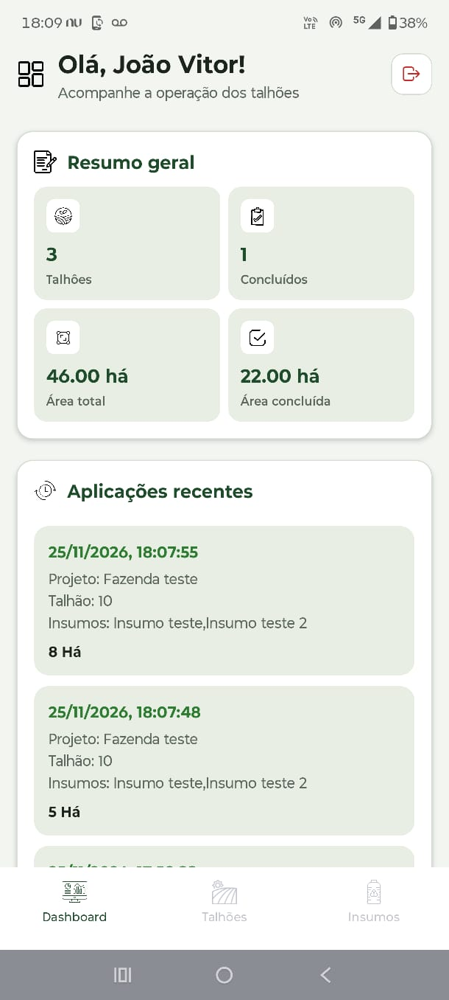
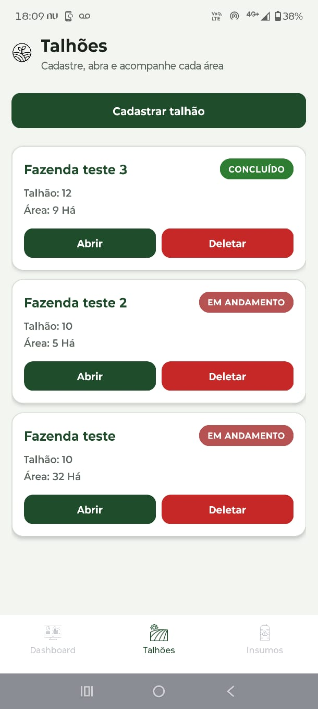
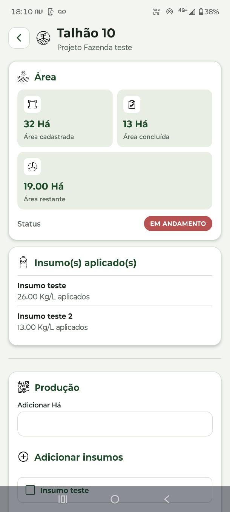

# 🌱 Talhão360

Aplicativo mobile para **gerenciamento de talhões e operações agrícolas**, desenvolvido com React Native, Expo e TypeScript.

## 📱 Sobre o projeto

O **Talhão360** é um aplicativo desenvolvido para facilitar o gerenciamento e o acompanhamento de operações agrícolas, permitindo o controle de talhões, insumos, aplicações e produção.

O projeto utiliza uma arquitetura **Offline First**, permitindo que o usuário continue utilizando as principais funcionalidades mesmo sem conexão com a internet, sincronizando os dados com o servidor quando a conexão estiver disponível.

## 🚀 Funcionalidades

- 🌱 Cadastro e gerenciamento de talhões
- 📐 Controle de área dos talhões
- 📊 Acompanhamento de área produzida e área restante
- 🧪 Cadastro e gerenciamento de insumos
- 🚁 Registro de aplicações de insumos
- 📋 Histórico de produções
- ✅ Atualização automática do status dos talhões
- 📶 Funcionamento offline (Offline First)
- 🔄 Sincronização de dados com o servidor
- 🔐 Autenticação de usuários
- 💾 Armazenamento local com SQLite

## 📸 Screenshots

### 🏠 Dashboard



### 🌱 Lista de Talhões



### 📋 Gerenciamento do Talhão



## 🛠️ Tecnologias utilizadas

### Frontend
- React Native
- Expo
- TypeScript
- Expo Router
- SQLite

### Backend
- Node.js
- Express
- MySQL
- Sequelize
- JWT (JSON Web Token)
- Bcrypt

## 🏗️ Arquitetura

O aplicativo utiliza uma arquitetura Offline First:

- **SQLite:** armazenamento local dos dados no dispositivo.
- **API REST:** comunicação entre o aplicativo e o servidor.
- **MySQL:** armazenamento persistente dos dados na nuvem.
- **Sincronização:** envio e recebimento de informações entre o banco local e o servidor.

Essa abordagem permite maior disponibilidade do aplicativo, mesmo em ambientes rurais com conexão limitada ou inexistente.

## 💾 Banco de dados

Principais tabelas utilizadas:

```text
usuarios
talhoes
insumos
aplicacoes
producoes
```

## 🎯 Objetivo

O Talhão360 tem como objetivo aplicar conhecimentos adquiridos durante minha formação em Engenharia de Software, explorando desenvolvimento mobile, desenvolvimento de APIs, bancos de dados relacionais, autenticação, sincronização de dados e construção de interfaces.

O projeto está em constante evolução, recebendo melhorias e novas funcionalidades.

## 👨‍💻 Desenvolvedor

**João Vitor Gonçalves**

Desenvolvido como projeto de aprendizado e desenvolvimento profissional.

---
